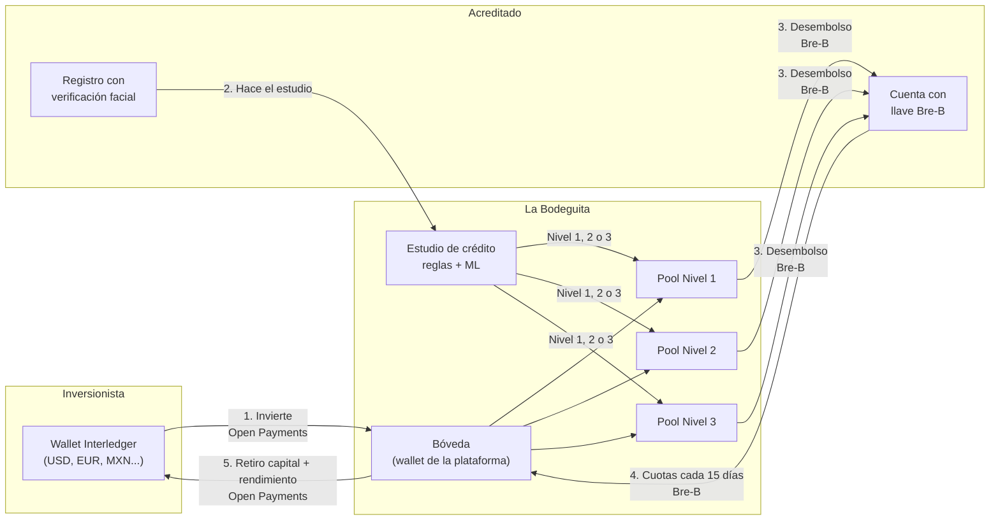
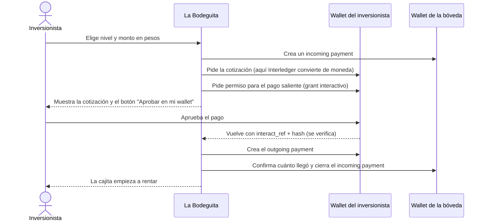
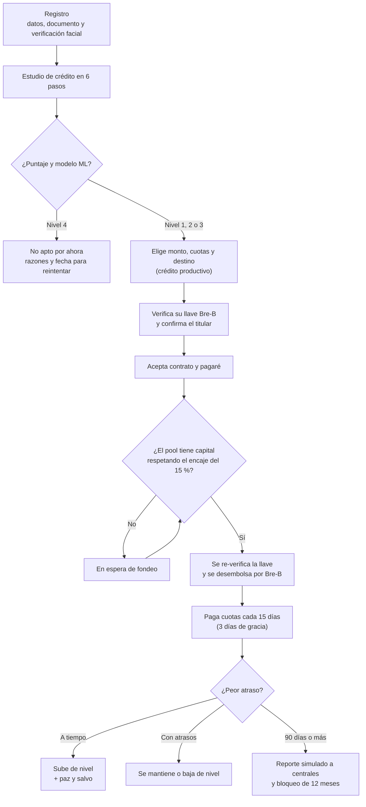

<p align="center">
  
</p>

<h1 align="center">La Bodeguita</h1>

<p align="center">
  Crédito justo para personas no bancarizadas en Colombia, financiado con inversión que llega por <b>Interledger</b>.<br />
  MVP de hackathon del equipo <b>Financial Kratos</b>.
</p>

---

## ¿Por qué existe?

En Colombia millones de personas no tienen historial bancario. Cuando necesitan plata para su negocio terminan en el
**gota a gota**: préstamos informales con intereses de más del 20 % mensual y cobros violentos.

La Bodeguita propone otra salida:

- **Inversionistas** (de Colombia o del exterior) ponen su dinero en una **cajita** por nivel de riesgo y reciben una
  rentabilidad esperada. El dinero entra y sale por **Open Payments (Interledger)**, en la moneda de su wallet.
- Con ese capital se dan **microcréditos productivos** a personas sin historial. Se aprueban con un **estudio de crédito
  propio** (datos alternativos + Machine Learning), no con centrales de riesgo.
- El crédito se desembolsa y se paga en pesos por **Bre-B**, el sistema de pagos inmediatos de Colombia.
- Pagar a tiempo **sube de nivel**: mejores condiciones en el siguiente crédito y un historial que antes no existía.

> Todo corre en sandbox y en la red de prueba de Interledger: **nunca se mueve dinero real**.

## Cómo funciona



### La inversión, paso a paso (Open Payments)



**Retiros:** el operador aprueba **una sola vez** en `/boveda` un permiso de pagos salientes de la bóveda, con un tope total.
Desde ahí cada retiro sale solo hacia la wallet del inversionista, sin que nadie lo apruebe. Interledger convierte a la moneda de
esa wallet.

### El crédito, paso a paso



## Qué es real y qué es simulado

| Parte | Estado |
|---|---|
| Inversión, retiro e inversión recurrente | **Real** con Open Payments en la red de prueba (simulado si no hay llaves) |
| Conversión entre la moneda del inversionista y la de la bóveda | **Real**: la define la cotización de Interledger |
| Conversión pesos → moneda de la bóveda | Tasa de mercado (open.er-api.com). `OP_COP_PER_UNIT` la fija a mano |
| Verificación de la llave Bre-B (titular y banco) | **Real** con el directorio Bre-B de Wompi, solo lectura (simulado si no hay llaves) |
| Desembolso por Bre-B | **Simulado con datos reales**: se arma el payout exacto para Wompi, pero no se envía |
| Pago de cuotas por Bre-B | Simulador de banco en `/mi-credito` |
| Lectura de documentos del estudio | IA (Gemini) con `GEMINI_API_KEY`; sin llave, trucos en el nombre del archivo |
| Verificación facial | **Local y gratuita**: prueba de vida (girar la cabeza) con MediaPipe y detección de rostros duplicados. No es de grado bancario |
| Contrato, pagaré y reporte a centrales de riesgo | Simulados |

## Reglas de negocio

Todo vive en [`src/lib/config.ts`](src/lib/config.ts).

| Nivel | Riesgo | Tasa del acreditado (E.A.) | Rentabilidad esperada del inversionista | Monto máximo | Plazo del crédito |
|---|---|---|---|---|---|
| 1 | Bajo | 24 % | 15,3 % | $5.000.000 | 30–365 días |
| 2 | Medio | 30 % | 17,9 % | $3.000.000 | 30–150 días |
| 3 | Alto | 36 % | 19,6 % | $1.000.000 | 30–90 días |

- **Rentabilidad del inversionista** = 85 % prestado × (tasa del acreditado − reserva para impagos − comisión de 3 puntos).
  Es **esperada, no garantizada**.
- **Encaje del 15 %**: cada pool presta como máximo el 85 % de su capital. El resto queda para los retiros.
- **Inversión mínima**: $100.000. Cada aporte dura **un año**. Antes de cumplirlo se puede retirar hasta el **50 %** del aporte.
  Máximo US$30.000 por retiro.
- **Crédito**: mínimo 2 cuotas, una cada 15 días desde el desembolso, cuota fija (sistema francés). El cupo es el menor entre el
  techo del nivel y lo que alcanza a pagar con el 50 % de su dinero libre.
- **Mora y nivel**: cada cuota tiene 3 días para pagarse. El peor atraso del último crédito decide el nivel del siguiente. Aviso a
  los 70 días y reporte simulado a los 90 ([`docs/reglas-cambio-de-nivel.md`](docs/reglas-cambio-de-nivel.md)).
- **Estudio de crédito**: puntaje de 0 a 100 con factor de confianza (lo declarado vale menos que lo respaldado con un documento o
  una referencia) y un modelo de regresión logística que ajusta el nivel ±1
  ([`docs/modelo-de-riesgo.md`](docs/modelo-de-riesgo.md), [`ml/README.md`](ml/README.md)).

## Correr el proyecto

### Requisitos

- **Node.js 20.9 o superior** y npm.
- Opcional: Python 3 para reentrenar el modelo de ML.

### Arrancar

```bash
npm install
npm run dev
```

Abre http://localhost:3000. **Sin `.env` todo funciona en modo simulado**: puedes recorrer la app completa sin ninguna llave.

| Comando | Para qué |
|---|---|
| `npm run dev` | Servidor de desarrollo en http://localhost:3000 |
| `npm run dev:https` | Igual, con HTTPS y abierto a la red local. Sirve para probar la cámara desde el celular |
| `npm run build` | Compila y revisa los tipos (debe pasar antes de cada commit) |
| `npm run lint` | Lint |
| `npm run ml:dataset` | Regenera el dataset sintético de `ml/dataset/` |
| `python3 ml/train_baseline.py` | Reentrena el modelo y escribe `ml/modelo/regresion_logistica.json` |

### Cuentas demo

Al arrancar se crean tres cuentas: **inversionista**, **acreditado** y **operador**. Sus correos y contraseñas están en
[`src/lib/demo-accounts.ts`](src/lib/demo-accounts.ts).

Ya vienen con datos para mostrar todo sin esperar:

- El inversionista tiene cajitas con aportes vencidos y en plazo, y un retiro hecho.
- El acreditado tiene el estudio hecho, un crédito **pagado** (con paz y salvo, que lo subió de nivel) y un crédito **activo**
  con una cuota por pagar.

El operador entra a `/boveda`, organizado en secciones: **Resumen** (alertas, indicadores de cartera y mora, pools con encaje,
bóveda y controles de demo), **Cartera**, **Usuarios** (verificación de identidad, suspender y reactivar cuentas), **Inversiones**
(cajitas y recurrentes), **Movimientos** y **Auditoría**. La bitácora registra quién hizo qué y cuándo en todos los flujos y está
encadenada por hash (si alguien edita o borra un evento, el panel lo detecta); todo se exporta a CSV. **Reiniciar demo** borra inversiones, créditos y movimientos, y vuelve a cargar los datos demo con la fecha de
hoy (conserva las cuentas y el permiso de la bóveda). **+15 días / +1 año** adelanta el reloj para ver crecer las cajitas y vencer
cuotas.

### Probar desde el celular (cámara)

La cámara solo funciona con HTTPS o en `localhost`. Para el celular:

1. `npm run dev:https`. La primera vez pide la contraseña de sudo para crear el certificado local.
2. Con el celular en la misma red wifi, abre `https://<IP de tu computador>:3000`.
3. Acepta la advertencia del certificado ("Avanzado → Continuar"): es tu propio servidor.

## Conectar las integraciones

Copia `cp .env.example .env` y completa lo que quieras activar. Cada integración que falte se simula.

### Open Payments (red de prueba de Interledger)

1. Crea una cuenta en https://wallet.interledger-test.dev.
2. Crea tres direcciones de pago **distintas**:
   - **Plataforma**: firma las peticiones. En *Settings → Developer Keys* genera una llave, copia el **Key ID** y guarda
     `private.key` en `secrets/`.
   - **Bóveda**: recibe las inversiones y paga los retiros. Fondéala con dinero de prueba.
   - **Inversionista de prueba**: desde donde se invierte. Debe ser **otra** wallet: la bóveda no puede pagarse a sí misma.
3. En `.env`: `OP_PLATFORM_WALLET_ADDRESS`, `OP_KEY_ID`, `OP_PRIVATE_KEY_PATH`, `OP_VAULT_WALLET_ADDRESS` y, para la cuenta demo,
   `OP_DEMO_INVESTOR_WALLET`.
4. Reinicia el servidor. En `/boveda` debe decir **"Open Payments conectado"**.
5. En `/boveda`, **Autorizar retiros automáticos** y apruébalo en la wallet de la bóveda. Solo hay que repetirlo si cambias la
   bóveda, borras `data/`, revocas el permiso o se gasta su tope (`OP_VAULT_GRANT_LIMIT_USD`).

El inversionista puede cambiar su wallet desde `/invertir` con **Guardar esta wallet**: sus cajitas pasan a la nueva.

Para ver la inversión recurrente sin esperar un mes: `OP_RECURRING_INTERVAL=PT5M`.

### Bre-B (Wompi)

Con credenciales del sandbox de Wompi, la llave Bre-B se verifica de verdad antes de desembolsar. El sandbox solo reconoce
`@elias123`, `1020304050`, `3001234567`, `ecolon@wompi.com` y `B00012345`. `WOMPI_RESOLVE_ENV=production` consulta el directorio
real (solo lectura); los payouts nunca se envían.

### Gemini y verificación facial

- `GEMINI_API_KEY`: lee los documentos del estudio con IA.
- `FACE_DESCRIPTOR_SECRET`: clave para cifrar los descriptores faciales. Define una propia fuera de la demo.

## Guion de demo (≈ 4 min)

1. **Invertir**: entra como inversionista, elige Nivel 3 y un monto, y aprueba en la wallet de prueba. La cajita aparece y
   empieza a rentar.
2. **Retirar**: retira una parte. Sale de la bóveda sin pedir aprobación y llega en la moneda de la wallet del inversionista.
3. **Acreditado**: muestra el estudio hecho, el crédito pagado con su paz y salvo y el nivel que subió, y el crédito activo con la
   cuota por pagar. Paga la cuota con el simulador Bre-B.
4. **Pedir crédito**: con un acreditado sin crédito vigente, elige monto, cuotas y destino, verifica la llave Bre-B, acepta el
   contrato y se desembolsa.
5. **Bóveda**: el operador ve la inversión (Interledger), el desembolso y el pago (Bre-B) en los movimientos. **+1 año** muestra
   el rendimiento acumulado.

Antes de presentar: **Reiniciar demo** en `/boveda` (deja la cuota por pagar con la fecha del día) y revisa que la bóveda diga
**"Autorizada"**.

## Estructura

```
src/
  app/                       pantallas y API (Next.js App Router)
    registro, login          cuenta nueva con verificación facial
    estudio, credito,        acreditado: estudio, pedir crédito, pagar cuotas
      mi-credito
    invertir                 inversionista: cajitas, retiros, inversión recurrente
    boveda                   operador: pools, permiso de la bóveda, revisión facial, reloj
    api/                     endpoints
  lib/
    config.ts                reglas de negocio (niveles, tasas, encaje, plazos)
    services.ts              cajitas, créditos, fondeo y pagos
    scoring.ts, riesgo-ml.ts estudio de crédito y modelo de ML
    credit-history.ts        mora, cambio de nivel y reporte simulado
    openpayments.ts          integración Open Payments
    breb.ts, payouts.ts      Bre-B: verificación de llaves y desembolso
    faceverify.ts            verificación facial (servidor)
    db.ts                    persistencia en data/db.json (solo demo)
    demo-*.ts                cuentas y datos precargados de la demo
docs/                        modelo de riesgo, cambio de nivel, verificación facial
ml/                          dataset sintético y entrenamiento del modelo
```

Stack: Next.js 16, React 19, TypeScript, Tailwind CSS 4 y `@interledger/open-payments`. La base de datos es un archivo JSON
(`data/db.json`, ignorado por git): borrar `data/` reinicia todo.

## Aviso

Es un prototipo de hackathon. Captar dinero del público y prestarlo es una actividad vigilada en Colombia (Superintendencia
Financiera). Antes de operar con dinero real hace falta la figura legal correspondiente, un proveedor de verificación de identidad
de grado bancario y revisar el tope de usura vigente.
